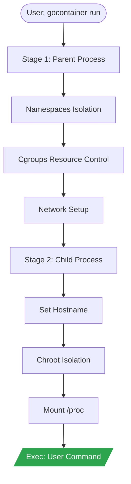

<div align="center">
  <h1>gocontainerruntime</h1>
  <p>A minimal container runtime (study purposes) implemented in Go using Linux namespaces and cgroups.</p>

  

  <br>

[](https://github.com/enoquesousa/gocontainerruntime/actions/workflows/ci.yml)
[](https://www.codefactor.io/repository/github/enoquesousa/gocontainerruntime)
[](https://pkg.go.dev/github.com/enoquesousa/gocontainerruntime)
[](https://github.com/enoquesousa/gocontainerruntime/blob/master/LICENSE)
[](https://github.com/enoquesousa/gocontainerruntime)
[](https://github.com/enoquesousa/gocontainerruntime/commits/master)

</div>

---

`gocontainerruntime` is a lightweight, educational container runtime that demonstrates Linux namespaces, cgroups and filesystem setup with chroot. Run only trusted root filesystems and trusted workloads: the process retains root privileges and this project is not a security sandbox for hostile code. See [SECURITY.md](SECURITY.md).

## Demonstration

```bash
# Download and verify the pinned Alpine rootfs (root is not needed for pull)
./gocontainer pull

# Run an isolated shell (Requires sudo for namespaces/cgroups)
sudo ./gocontainer run /bin/sh
```

## Technology Stack

| Technology     | Role                                                               |
| -------------- | ------------------------------------------------------------------ |
| Go 1.26.10     | Core language, path-confined filesystem APIs and logic              |
| Linux Syscalls | Namespaces (CLONE_NEWNS, CLONE_NEWUTS, CLONE_NEWPID, CLONE_NEWNET) |
| Cgroups v1     | Resource limits (100MB Memory, 512 CPU shares)                     |
| Cobra          | CLI Framework                                                      |
| Alpine Linux   | Lightweight rootfs for the container                               |

## Prerequisites

- Go >= 1.26.10
- Linux Kernel >= 4.x (with support for namespaces and cgroups v1)
- Root Privileges (required for namespace and network manipulation)

## Installation and Usage

### As a binary

```bash
go install github.com/enoquesousa/gocontainerruntime@latest
```

### From source

```bash
git clone https://github.com/enoquesousa/gocontainerruntime.git
cd gocontainerruntime
make build
# Optional: Pull default rootfs
make pull
# Run shell
make run
```

## Makefile Targets

| Target  | Description                                                    |
| ------- | -------------------------------------------------------------- |
| `build` | Compiles the `gocontainer` binary                              |
| `clean` | Removes binary and cache files                                 |
| `test`  | Executes the unit test suite                                   |
| `pull`  | Downloads and extracts the Alpine Linux minirootfs             |
| `run`   | Starts an interactive container with `/bin/sh` (requires sudo) |

## Architecture

The runtime demonstrates container setup in two stages. These mechanisms do not
provide the complete security boundary of a production container runtime.

<div align="center">



</div>

1. **Stage 1 (Parent)**: Validates explicit environment selections, creates namespaces (UTS, PID, NS, NET) and memory/CPU cgroups, and re-executes the internal `child` command with a minimal environment.
2. **Stage 2 (Child)**: Receives the selected environment through an internal pipe, sets the hostname (`gocontainer`), performs the `chroot`, mounts `/proc`, and executes the user's command. Credential values are not placed in the internal command line.

See more details in [docs/architecture.md](docs/architecture.md).

## API Reference

Detailed documentation for internal functions and packages is available at:
[pkg.go.dev/github.com/enoquesousa/gocontainerruntime](https://pkg.go.dev/github.com/enoquesousa/gocontainerruntime)

## Configuration

The runtime has no database login, API server, session token or refresh flow.
Linux privileges authorize namespace/cgroup operations. The following build-time
defaults control the image cache:

| Variable    | Description                     | Type   | Default                  |
| ----------- | ------------------------------- | ------ | ------------------------ |
| `cacheDir`  | Directory for rootfs extraction | String | `./cache/alpine_rootfs`  |
| `alpineURL` | Pinned HTTPS image source      | String | Alpine 3.24.3 x86_64 Minirootfs |

`pull` checks the pinned SHA-256 before extracting into a private temporary
directory. It confines archive writes to that directory, supports the image's
links, and publishes the cache only after success. An existing cache is not
silently overwritten; preserve anything you need before removing it yourself.
The cache and its parent directory must be controlled by the operator.
An image extracted by an older version is not upgraded automatically, and `run`
does not re-authenticate an existing cache or a custom rootfs.

### Environment and credentials

The default container environment contains a fixed `PATH`, `HOME=/root` and
`LANG=C`. Host API keys, cloud credentials, proxy settings, agent sockets and other
variables are not copied automatically. Use a repeated `--env NAME` to import a
specific variable already present in the runtime's environment:

```bash
# Public example value; --preserve-env imports only this named variable via sudo.
export APP_MODE=demo
sudo --preserve-env=APP_MODE ./gocontainer run --env APP_MODE ./cache/alpine_rootfs /bin/sh
```

`--env` accepts names only, not `NAME=value`. Supply runtime flags before the
first positional argument; everything after the command belongs to that command.
The resulting environment is limited to 64 KiB; the internal handoff is bounded
separately and its descriptor is closed before the workload starts.
With a single positional command the cached image is used. To pass command
arguments, provide the rootfs explicitly:

```bash
sudo ./gocontainer run ./cache/alpine_rootfs /bin/echo hello
```

An explicitly imported variable is visible to the workload and its descendants.
The runtime resolves the first command using its fixed `PATH` inside the rootfs;
use an absolute command path for another location. An imported `PATH` applies to
the workload and the commands it subsequently launches.
Secrets remain in process memory/environment; they are not encrypted or revoked
by the runtime. Do not put secret values in shell history or command arguments.
Use a trusted source for the environment and restrict any sudo preservation to
the required names. See the [credential flow and limits](SECURITY.md#credential-flow).

### Tests

`go test ./...` and CI exercise helpers, archive extraction and harmless child
processes. They do not create privileged containers. The namespace/cgroup
integration test requires an explicit opt-in and a disposable Linux host with
cgroups v1; it is not enabled by becoming root alone.
The opt-in variables are `GOCONTAINER_PRIVILEGED_TESTS=1` and
`GOCONTAINER_TEST_ROOTFS` pointing to a trusted rootfs. CI removes both variables.

## Roadmap

- [x] Phase 1: Isolated Fork (Namespaces)
- [x] Phase 2: File Isolation (Chroot)
- [x] Phase 3: Resource Control (Cgroups)
- [x] Phase 4: Basic Networking (Netns)
- [x] Phase 5: Professional Interface and Images

## Contributing

Contributions are welcome! See the full guide at [CONTRIBUTING.md](CONTRIBUTING.md).

## License

Distributed under the MIT License. See [LICENSE](LICENSE) for more information.

<div align="center">

## Author

**Enoque Sousa**

[](https://www.linkedin.com/in/enoque-sousa-bb89aa168/)
[](https://github.com/enoquesousa)
[](https://enoquesousa.vercel.app)

**[⬆ Back to top](#gocontainerruntime)**

Made with ❤️ by [Enoque Sousa](https://github.com/enoquesousa)

**Project Status:** Archived — Study Project

</div>
